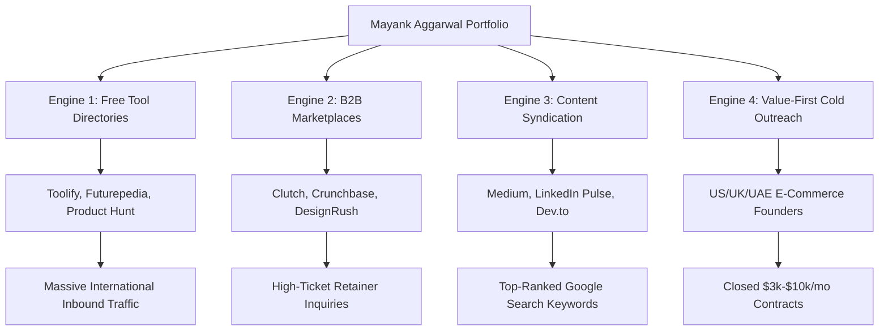

# Worldwide Client Acquisition & Authority Backlink Playbook

**Target Goal**: Attract high-paying international clients (USA, UK, UAE, Australia, Canada, Europe) and generate sustainable, compounding global search traffic without risking Google algorithmic penalties.

---

## ⚠️ 1. The Critical Truth About "100,000 Automated Backlinks"

In modern SEO (Google SpamBrain 2026), **link quality and contextual relevance dominate volume**:

| Strategy | Automated 100k Link Blast (Spam) | High-DA Authority & Tool Engine (Recommended) |
| :--- | :--- | :--- |
| **Source** | Bot comments, PBNs, Russian/Chinese link networks | Clutch, Product Hunt, GitHub, Medium, Toolify, Crunchbase |
| **Google Algorithm Reaction** | **Manual Penalty & Domain De-indexing** | **Higher Domain Authority & Page 1 Rankings** |
| **Client Perception** | Marked as malicious/toxic web spam | Seen as a world-class performance marketing & AI agency |
| **Client Acquisition** | **0 real clients** (bots don't buy) | **High-ticket $2,000 – $10,000/mo retainers** |
| **Sustainability** | Crashes traffic to zero in 14–30 days | Grows compounding organic traffic for years |

> [!CAUTION]
> Never buy blast packages offering "100,000 backlinks for $10" on Fiverr or black-hat forums. Google's SpamBrain algorithm flags sudden spikes of low-quality links immediately, which destroys your search rankings permanently.

---

## 🚀 2. The 4-Engine Worldwide Client Acquisition System

---

## 🛠️ Engine 1: The "Engineering as Marketing" Viral Tool Flywheel

Your website has 3 high-utility interactive tools already live in production:
1. **Meta Ads ROAS & Profit Calculator** (`/tools/meta-ads-roas-calculator`)
2. **AI Video Prompt Generator for Runway Gen-3 & Kling** (`/tools/ai-video-prompt-generator`)
3. **Viral Reel Hook Generator** (`/tools/reel-hook-generator`)

Submitting these 3 tools to international AI and marketing tool directories generates **millions of monthly impressions**, high-authority do-follow backlinks, and direct traffic from founders searching for AI and ad solutions.

### Top 15 Directories to Submit Right Now:

| # | Directory | Domain Authority | Category | Submission URL | Suggested Anchor / Title |
| :-: | :--- | :-: | :--- | :--- | :--- |
| 1 | **Product Hunt** | 91 | Tech Launch | [producthunt.com/posts/new](https://www.producthunt.com/posts/new) | Free Meta Ads ROAS Calculator & Video Tools |
| 2 | **Toolify.ai** | 82 | AI Aggregator | [toolify.ai/submit](https://www.toolify.ai/submit) | AI Video Prompt Generator by Mayank |
| 3 | **There's An AI For That** | 84 | AI Catalog | [theresanaiforthat.com/submit/](https://theresanaiforthat.com/submit/) | AI Video Creative Prompt Engine |
| 4 | **Futurepedia** | 81 | AI Directory | [futurepedia.io/submit-tool](https://www.futurepedia.io/submit-tool) | Generative Video Ad Prompt Generator |
| 5 | **FutureTools.io** | 76 | AI Marketing | [futuretools.io/submit-a-tool](https://www.futuretools.io/submit-a-tool) | Meta Ads ROAS & Creative Planning Suite |
| 6 | **AlternativeTo** | 85 | Software Alternatives | [alternativeto.net/software/add/](https://alternativeto.net/software/add/) | Free Alternative to Paid ROAS Calculators |
| 7 | **BetaList** | 82 | Startup Launch | [betalist.com/submit](https://betalist.com/submit) | Mayank Aggarwal Performance Tools |
| 8 | **SaaSHub** | 77 | Software Discovery | [saashub.com/submit](https://www.saashub.com/submit) | AI Video & Ad Scaling Tools |
| 9 | **TopAI.tools** | 74 | AI Directory | [topai.tools/submit](https://topai.tools/submit) | Reel Hook & Prompt Generator |
| 10 | **Uneed.best** | 73 | Curated Tools | [uneed.best/submit](https://uneed.best/submit) | E-commerce Creative Scaling Kit |
| 11 | **MicroLaunch** | 68 | Indie Launch | [microlaunch.net/submit](https://microlaunch.net/submit) | Meta Ads Profit & Break-Even Calculator |
| 12 | **CrazyToolbox** | 65 | Web Utilities | [crazytoolbox.com](https://crazytoolbox.com) | Free Video Hook Generator |
| 13 | **AI Valley** | 71 | AI Community | [aivalley.ai/submit](https://aivalley.ai/submit) | AI Video Ad Prompt Engine |
| 14 | **StartupStash** | 78 | Entrepreneur Tools | [startupstash.com](https://startupstash.com) | Performance Marketing Calculators |
| 15 | **All Things AI** | 72 | AI Directory | [allthingsai.com](https://allthingsai.com) | AI Commercial Production Toolkit |

---

## 💼 Engine 2: The B2B High-Ticket Marketplace Network

International enterprise clients (US, UK, UAE) hire agencies and senior consultants from verified B2B directories:

1. **Clutch.co (DA 92)**:
   - Register at [clutch.co/get-listed](https://clutch.co/get-listed)
   - Profile copy is already prepared in [`seo/backlinks/09-clutch-agency-profile.md`](file:///c:/Users/pc/Desktop/MAYANK%20PORTFOLIO%20WEBSITE/seo/backlinks/09-clutch-agency-profile.md).
   - Get 2–3 past clients or colleagues to leave a review. Top-ranked Clutch profiles generate $10k+ client leads every month on autopilot.
2. **Crunchbase (DA 91)**:
   - Add company profile: **Klikwise Digital Marketing**
   - Add founder: **Mayank Aggarwal**
   - Add website: `https://mayankaggarwal-one.vercel.app`
3. **GoodFirms (DA 87) & DesignRush (DA 84)**:
   - List under *Top Meta Advertising Agencies* and *Top AI Video Production Companies*.
4. **Behance (DA 94) & Vimeo (DA 95)**:
   - Upload high-resolution case studies and AI showreels linking back to `/portfolio`.

---

## ✍️ Engine 3: Parasite SEO & Content Syndication

"Parasite SEO" allows you to rank on Google's Page 1 for ultra-competitive international keywords (e.g., *"Meta Advantage+ shopping scaling guide"*, *"Runway Gen-3 commercial prompts"*) by publishing on platforms with DA 90+:

Your repository already contains pre-formatted articles ready to copy and paste:
* **Dev.to (DA 91)**: [`seo/backlinks/02-devto-meta-ads-roas.md`](file:///c:/Users/pc/Desktop/MAYANK%20PORTFOLIO%20WEBSITE/seo/backlinks/02-devto-meta-ads-roas.md)
* **Hashnode (DA 88)**: [`seo/backlinks/03-hashnode-generative-ai-commercials.md`](file:///c:/Users/pc/Desktop/MAYANK%20PORTFOLIO%20WEBSITE/seo/backlinks/03-hashnode-generative-ai-commercials.md)
* **Medium (DA 96)**: [`seo/backlinks/04-medium-creative-fatigue.md`](file:///c:/Users/pc/Desktop/MAYANK%20PORTFOLIO%20WEBSITE/seo/backlinks/04-medium-creative-fatigue.md)
* **Product Hunt Launch Kit**: [`seo/backlinks/05-product-hunt-launch-kit.md`](file:///c:/Users/pc/Desktop/MAYANK%20PORTFOLIO%20WEBSITE/seo/backlinks/05-product-hunt-launch-kit.md)
* **LinkedIn Pulse (DA 98)**: [`seo/backlinks/06-linkedin-pulse-article.md`](file:///c:/Users/pc/Desktop/MAYANK%20PORTFOLIO%20WEBSITE/seo/backlinks/06-linkedin-pulse-article.md)
* **Reddit r/PPC (DA 97)**: [`seo/backlinks/07-reddit-ppc-case-study.md`](file:///c:/Users/pc/Desktop/MAYANK%20PORTFOLIO%20WEBSITE/seo/backlinks/07-reddit-ppc-case-study.md)
* **Quora (DA 93)**: [`seo/backlinks/08-quora-high-ranking-answer.md`](file:///c:/Users/pc/Desktop/MAYANK%20PORTFOLIO%20WEBSITE/seo/backlinks/08-quora-high-ranking-answer.md)

---

## 🎯 Engine 4: Outbound High-Ticket Client Acquisition Script

To sign international clients paying **$2,500 – $7,500/month** within the next 30 days, use this value-first cold outreach strategy on LinkedIn and Email:

### LinkedIn / Cold Email Outreach Template
> **Subject**: quick question on {{brand_name}}'s Meta creative fatigue
>
> Hi {{first_name}},
>
> Noticed you're scaling ad spend for {{brand_name}} on Meta.
>
> Most direct-to-consumer brands hit a ceiling at 2.2x ROAS due to creative fatigue. We built an interactive **ROAS & Profit Calculator** and an **AI Commercial Production Framework** that cut our creative test costs by 70% while pushing blended ROAS to 4.1x:
>
> 👉 Live Calculator: https://mayankaggarwal-one.vercel.app/tools/meta-ads-roas-calculator
> 👉 Showreel & Case Studies: https://mayankaggarwal-one.vercel.app/portfolio
>
> I analyzed 3 of your current live ad creatives and put together 2 custom video hook concepts that would immediately lower your CPA.
>
> Mind if I send over a quick 2-minute video breakdown?
>
> Best,  
> **Mayank Aggarwal**  
> Founder, Klikwise Performance Marketing  
> New Delhi & Worldwide

---

## 📋 Action Checklist for the Next 7 Days

- [ ] **Day 1**: Submit the 3 tools to **Product Hunt**, **Toolify.ai**, and **There's An AI For That**.
- [ ] **Day 2**: Create your verified **Clutch.co** and **Crunchbase** company profiles.
- [ ] **Day 3**: Copy & publish the Medium article from [`seo/backlinks/04-medium-creative-fatigue.md`](file:///c:/Users/pc/Desktop/MAYANK%20PORTFOLIO%20WEBSITE/seo/backlinks/04-medium-creative-fatigue.md).
- [ ] **Day 4**: Publish the Reddit case study in `r/PPC` and `r/FacebookAds` using [`seo/backlinks/07-reddit-ppc-case-study.md`](file:///c:/Users/pc/Desktop/MAYANK%20PORTFOLIO%20WEBSITE/seo/backlinks/07-reddit-ppc-case-study.md).
- [ ] **Day 5**: Submit the AI Prompt Generator to **Futurepedia** and **FutureTools**.
- [ ] **Day 6**: Publish the LinkedIn Pulse thought leadership article from [`seo/backlinks/06-linkedin-pulse-article.md`](file:///c:/Users/pc/Desktop/MAYANK%20PORTFOLIO%20WEBSITE/seo/backlinks/06-linkedin-pulse-article.md).
- [ ] **Day 7**: Send 25 personalized outreach messages to US/UK e-commerce founders on LinkedIn using the value-first template.
