# Comprehensive SEO, AEO & GEO Keyword Research Matrix

**Site URL**: `https://mayankaggarwal-one.vercel.app`  
**Brand**: Mayank Aggarwal — Klikwise Digital Marketing & Generative AI Studio  
**Primary Market**: India (Delhi NCR, Gurugram, Noida, Mumbai, Bengaluru) & Global High-Growth Brands  
**Core Expertise**: Performance Meta Ads, Generative AI Video Production (Runway Gen-3, Kling AI), Social Media Retention Strategy, Neural Voice Synthesis (ElevenLabs), and Full-Funnel Creative Direction.

---

## 1. Primary Core Keywords (High-Intent Pillar Targets)

| Keyword | Search Intent | Monthly Vol (IN) | Target URL | Primary SERP Target |
| :--- | :--- | :--- | :--- | :--- |
| `performance marketing specialist delhi` | Transactional | 1,600 | `/` | Local Map Pack & Founder Bio |
| `meta ads specialist india` | Commercial | 2,400 | `/services/performance-marketing` | Featured Snippet / Pillar |
| `ai video ads agency` | Commercial | 1,900 | `/services/ai-video-creation` | GEO Citation / AI Overview |
| `social media management delhi` | Commercial / Local | 1,800 | `/services/social-media-management` | Local 3-Pack & Service Hub |
| `runway gen-3 video creation services` | Transactional | 900 | `/services/ai-video-creation` | AI Overview & Niche Pillar |
| `meta ads roas calculator india` | Informational / Utility | 1,200 | `/tools/meta-ads-roas-calculator` | Interactive WebApp Rich Result |
| `ai video prompt generator for ads` | Informational / Utility | 1,400 | `/tools/ai-video-prompt-generator` | Tool Schema / Sitelink Snippet |
| `viral reel hook generator free` | Informational / Utility | 2,100 | `/tools/reel-hook-generator` | Tool Schema / Social Snippet |
| `digital marketing consultant delhi ncr` | Commercial / Local | 2,800 | `/locations/delhi` | Local Business Schema |
| `performance marketing case studies india` | Informational / Commercial | 800 | `/portfolio` | Creative Portfolio / Reviews |

---

## 2. Secondary Keywords (Service Hub & Topic Sub-Pillars)

| Keyword | Intent | Target URL | Assigned Role |
| :--- | :--- | :--- | :--- |
| `facebook ads manager freelancer delhi` | Transactional | `/` | Homepage Supporting Keyword |
| `instagram paid ads management services` | Commercial | `/services/performance-marketing` | Meta Ads Service Supporting |
| `ecommerce roas improvement strategy` | Informational | `/blog/roas-vs-mer-which-marketing-metric-matters-2026` | E-commerce Attribution Article |
| `generative ai video ads for d2c brands` | Commercial | `/services/ai-video-creation` | AI Service Supporting |
| `elevenlabs neural voiceover services india` | Commercial | `/services/ai-voiceover` | Voiceover Service Target |
| `high retention instagram reel hooks` | Informational | `/blog/viral-instagram-reels-hook-psychology-formulas` | Reel Strategy Article |
| `creative fatigue meta ads solutions` | Informational | `/blog/meta-ads-creative-fatigue-testing-framework` | Creative Testing Guide |
| `advantage plus shopping campaigns setup` | Informational | `/blog/meta-advantage-plus-shopping-campaigns-handbook` | Meta ASC Guide |
| `conversions api meta ads setup delhi` | Transactional | `/blog/meta-ads-pixel-conversions-api-setup-checklist` | Technical Tracking Guide |
| `kling ai video production company` | Commercial | `/services/ai-video-creation` | AI Engine Secondary Target |
| `b2b meta ads lead generation cost` | Informational | `/blog/how-to-reduce-meta-ads-cpl-india` | Lead Gen CPL Guide |
| `digital marketing agency connaught place` | Local / Commercial | `/locations/delhi` | Delhi NCR Micro-Market |
| `meta ads agency cyber city gurugram` | Local / Commercial | `/locations/gurugram` | Gurugram Tech Hub Target |
| `d2c marketing consultant noida` | Local / Commercial | `/locations/noida` | Noida Startup Hub Target |
| `performance marketing consultant mumbai bkc` | Local / Commercial | `/locations/mumbai` | Mumbai Corporate Target |
| `ai ad agency bangalore koramangala` | Local / Commercial | `/locations/bangalore` | Bangalore Startup Ecosystem |
| `midjourney commercial prompt templates` | Informational | `/blog/midjourney-v6-product-photography-prompt-guide` | Prompt Guide |
| `heygen ai avatar commercial pricing` | Commercial | `/blog/heygen-ai-spokesperson-video-ugc-pipeline` | Avatar UGC Article |
| `first 3 second reel hook formula` | Informational | `/blog/first-3-second-hook-formulas-tiktok-reels` | Video Retention Guide |
| `d2c festive season meta ad strategy` | Informational | `/blog/diwali-festive-e-commerce-meta-ads-playbook` | Festive Seasonal Playbook |
| `performance marketing retainer cost india` | Commercial | `/services/growth-retainer` | Retainer Pricing Page |
| `meta ads broad targeting vs lookalikes` | Informational | `/blog/meta-ads-custom-audiences-lookalike-strategy` | Audience Strategy Guide |
| `core web vitals optimization freelancer delhi` | Commercial | `/blog/core-web-vitals-inp-lcp-optimization-react` | Technical SEO Article |
| `marketing efficiency ratio mer benchmark` | Informational | `/blog/roas-vs-mer-which-marketing-metric-matters-2026` | Metric Benchmark Guide |
| `ai voice clone dubbing hindi english` | Informational | `/blog/elevenlabs-multilingual-voice-cloning-ad-dubbing` | Multilingual Audio Guide |
| `b2b linkedin and meta ad synergy` | Informational | `/blog/b2b-meta-ads-lead-generation-funnel` | B2B Funnel Article |
| `ad creative testing 3x3 framework` | Informational | `/blog/meta-ads-creative-fatigue-testing-framework` | Framework Reference |
| `hire freelance performance marketer india` | Transactional | `/contact` | Lead Conversion Page |
| `ugc ad script writing formula` | Informational | `/blog/ugc-style-scriptwriting-templates-direct-response` | Creative Scriptwriting |
| `generative engine optimization geo agency` | Commercial | `/blog/generative-engine-optimization-geo-playbook-2026` | GEO Pillar Guide |

---

## 3. Long-Tail Search Queries (High-Intent Conversion Focus)

1. `how to fix dropping meta ads roas after scaling budget` -> `/blog/roas-vs-mer-which-marketing-metric-matters-2026`
2. `best runway gen 3 camera motion prompt keywords for product ads` -> `/blog/runway-gen-3-alpha-camera-prompts-cheat-sheet`
3. `how to setup conversions api on shopify using cloudflare worker` -> `/blog/meta-ads-pixel-conversions-api-setup-checklist`
4. `cost of hiring a freelance meta ads specialist in delhi ncr 2026` -> `/locations/delhi`
5. `how to test 20 ad creatives a week without burning budget` -> `/blog/meta-ads-creative-fatigue-testing-framework`
6. `difference between roas and marketing efficiency ratio e-commerce` -> `/blog/roas-vs-mer-which-marketing-metric-matters-2026`
7. `prompt guide for hyper realistic perfume bottle in midjourney v6` -> `/blog/midjourney-v6-product-photography-prompt-guide`
8. `step by step kling ai image to video workflow for luxury jewelry` -> `/blog/kling-ai-vs-runway-gen-3-commercial-comparison`
9. `how to lower cost per lead on meta ads for real estate in gurugram` -> `/locations/gurugram`
10. `psychological hook templates for b2b saas reels on instagram` -> `/blog/viral-instagram-reels-hook-psychology-formulas`
11. `how to eliminate robotic artifacting in elevenlabs voiceover ads` -> `/blog/elevenlabs-voice-settings-audio-fidelity-guide`
12. `meta ads account structure after ios 14 and ios 17 privacy changes` -> `/blog/meta-advantage-plus-shopping-campaigns-handbook`
13. `how to optimize react portfolio for google page speed 100 on mobile` -> `/blog/core-web-vitals-inp-lcp-optimization-react`
14. `free calculated roas threshold spreadsheet formula meta ads` -> `/tools/meta-ads-roas-calculator`
15. `camera pan zoom tilt command strings for cinematic ai commercials` -> `/tools/ai-video-prompt-generator`
16. `viral question style hooks that stop scrolling on mobile feed` -> `/tools/reel-hook-generator`
17. `how to do geo generative engine optimization for freelance portfolio` -> `/blog/generative-engine-optimization-geo-playbook-2026`
18. `meta ads lookalike audiences still working in 2026 india` -> `/blog/meta-ads-custom-audiences-lookalike-strategy`
19. `best prompt formulas for commercial beverage splash in runway gen 3` -> `/blog/runway-gen-3-alpha-camera-prompts-cheat-sheet`
20. `freelance digital marketing retainer contracts terms and pricing delhi` -> `/services/growth-retainer`
21. `how to build an automated lead qualification quiz on meta ads` -> `/blog/meta-lead-gen-instant-forms-vs-landing-pages`
22. `d2c fashion brand meta advertising budget allocation template` -> `/blog/d2c-meta-ads-budget-allocation-calculator`
23. `ugc creator brief template for d2c skincare brands india` -> `/blog/ugc-style-scriptwriting-templates-direct-response`
24. `how to track meta ads offline conversions for physical clinic delhi` -> `/locations/delhi`
25. `what is generative engine optimization geo vs traditional seo` -> `/blog/generative-engine-optimization-geo-playbook-2026`
26. `best ai video generators for commercial production tested side by side` -> `/blog/kling-ai-vs-runway-gen-3-commercial-comparison`
27. `how to optimize video ad watch time retention curve beyond 50 percent` -> `/blog/first-3-second-hook-formulas-tiktok-reels`
28. `hindi voiceover generator with natural conversational accent elevenlabs` -> `/blog/elevenlabs-multilingual-voice-cloning-ad-dubbing`
29. `why is my cpm on meta ads spiking in india during festive quarter` -> `/blog/diwali-festive-e-commerce-meta-ads-playbook`
30. `b2b tech startup meta ads lead form validation rules` -> `/blog/b2b-meta-ads-lead-generation-funnel`
31. `how to scale facebook ad spend from 50k to 5 lakh monthly safely` -> `/blog/scaling-meta-ads-budget-vertical-horizontal-rules`
32. `what is good roas for apparel brand on instagram ads india` -> `/tools/meta-ads-roas-calculator`
33. `can you generate lip sync multilingual video with heygen and elevenlabs` -> `/blog/heygen-ai-spokesperson-video-ugc-pipeline`
34. `freelance growth marketer vs digital marketing agency in noida` -> `/locations/noida`
35. `how to write camera prompts for drone shots in runway gen-3` -> `/blog/runway-gen-3-alpha-camera-prompts-cheat-sheet`
36. `meta ads attribution window 7 day click vs 1 day view explained` -> `/blog/meta-ads-attribution-window-click-view-guide`
37. `best practice for testing reel hooks with dark posting on instagram` -> `/blog/meta-ads-creative-fatigue-testing-framework`
38. `how to calculate break even roas before launching meta ads` -> `/tools/meta-ads-roas-calculator`
39. `ai generated commercials legal rights commercial use midjourney runway` -> `/blog/ai-commercial-copyright-commercial-use-laws-2026`
40. `best digital marketing strategist in south delhi for luxury brands` -> `/locations/delhi`
41. `how to setup llms txt file for generative ai citations on website` -> `/blog/generative-engine-optimization-geo-playbook-2026`
42. `audio mastering checklist for elevenlabs voiceover video ads` -> `/blog/elevenlabs-voice-settings-audio-fidelity-guide`
43. `meta ads exclusions why you must exclude past 30 days buyers` -> `/blog/meta-advantage-plus-shopping-campaigns-handbook`
44. `interactive roas calculator for d2c marketers free tool` -> `/tools/meta-ads-roas-calculator`
45. `top 5 digital marketing services for startups in bangalore koramangala` -> `/locations/bangalore`
46. `meta conversions api gateway vs stape vs direct cloudflare setup` -> `/blog/meta-ads-pixel-conversions-api-setup-checklist`
47. `how to write negative hooks for high retention reels` -> `/tools/reel-hook-generator`
48. `performance creative testing matrix sample download` -> `/blog/meta-ads-creative-fatigue-testing-framework`
49. `why are my instagram ads getting comments but zero purchases` -> `/blog/meta-ads-comment-moderation-social-proof-tactics`
50. `hire mayank aggarwal digital marketing specialist contact details` -> `/contact`

---

## 4. Question-Style Keywords (AEO / Featured Snippets / Voice Search)

| Question Query | Target URL | Expected SERP Feature |
| :--- | :--- | :--- |
| `What is a good ROAS for Meta Ads in India?` | `/tools/meta-ads-roas-calculator` | Featured Snippet Table / Number Block |
| `How do you stop scroll in the first 3 seconds of a Reel?` | `/blog/first-3-second-hook-formulas-tiktok-reels` | Numbered List Snippet |
| `How to write camera movement prompts in Runway Gen-3 Alpha?` | `/blog/runway-gen-3-alpha-camera-prompts-cheat-sheet` | Code block / Definition Snippet |
| `What is the difference between ROAS and MER?` | `/blog/roas-vs-mer-which-marketing-metric-matters-2026` | Comparison Table Snippet |
| `Why is my Meta Ads CPL so high in India?` | `/blog/how-to-reduce-meta-ads-cpl-india` | People Also Ask (PAA) Accordion |
| `How does Generative Engine Optimization (GEO) work?` | `/blog/generative-engine-optimization-geo-playbook-2026` | AI Overview Definition |
| `Can AI video replace real commercial video production?` | `/blog/kling-ai-vs-runway-gen-3-commercial-comparison` | Direct Answer Box |
| `How to fix Meta Pixel and Conversions API deduplication?` | `/blog/meta-ads-pixel-conversions-api-setup-checklist` | Ordered Step Snippet |
| `How much does a freelance Meta Ads specialist charge in Delhi?` | `/locations/delhi` | Local PAA Box |
| `What is Advantage+ Shopping Campaign on Meta?` | `/blog/meta-advantage-plus-shopping-campaigns-handbook` | Featured Snippet Paragraph |

---

## 5. Local Search Queries (Delhi NCR, Gurugram, Noida, Mumbai, Bangalore)

- `meta ads freelancer south delhi` -> `/locations/delhi`
- `performance marketing agency connaught place delhi` -> `/locations/delhi`
- `digital marketing consultant near me delhi` -> `/locations/delhi`
- `freelance meta ads expert gurugram cyber city` -> `/locations/gurugram`
- `instagram marketing consultant golf course road gurugram` -> `/locations/gurugram`
- `ecommerce performance marketer noida sector 62` -> `/locations/noida`
- `d2c marketing agency noida express way` -> `/locations/noida`
- `performance marketing specialist mumbai bkc` -> `/locations/mumbai`
- `meta ads media buyer bandra andheri mumbai` -> `/locations/mumbai`
- `startup growth marketing consultant bangalore indiranagar` -> `/locations/bangalore`
- `generative ai video studio koramangala bangalore` -> `/locations/bangalore`
- `digital marketing services for restaurants and clinics delhi` -> `/locations/delhi`

---

## 6. Hindi / Hinglish Search Queries (Voice Search & Natural Conversations)

- `meta ads me roas kaise badhaye` -> `/blog/roas-vs-mer-which-marketing-metric-matters-2026`
- `instagram reel viral hook templates hindi` -> `/blog/viral-instagram-reels-hook-psychology-formulas`
- `ai video kaise banaye runway gen 3 se` -> `/blog/runway-gen-3-alpha-camera-prompts-cheat-sheet`
- `meta ads ka cost per lead kam kaise kare` -> `/blog/how-to-reduce-meta-ads-cpl-india`
- `best digital marketing freelancer delhi me kaun hai` -> `/locations/delhi`
- `elevenlabs se natural hindi voiceover kaise banaye` -> `/blog/elevenlabs-multilingual-voice-cloning-ad-dubbing`
- `delhi ncr me facebook ads specialist hire karna hai` -> `/contact`
- `ecommerce store ke liye profitable ads kaise chalaye` -> `/services/performance-marketing`

---

## 7. Topic Clusters & Internal Linking Architecture

```mermaid
graph TD
    Home["Homepage: Mayank Aggarwal (/)"]
    
    subgraph Cluster1["Topic Cluster 1: Performance Meta Ads (Pillar: /services/performance-marketing)"]
        P1["Pillar: Meta Ads Management (/services/performance-marketing)"]
        B1["ASC Campaigns Handbook (/blog/meta-advantage-plus-shopping-campaigns-handbook)"]
        B2["Creative Fatigue Framework (/blog/meta-ads-creative-fatigue-testing-framework)"]
        B3["Reduce Meta Ads CPL (/blog/how-to-reduce-meta-ads-cpl-india)"]
        B4["ROAS vs MER Guide (/blog/roas-vs-mer-which-marketing-metric-matters-2026)"]
        B5["Pixel & CAPI Checklist (/blog/meta-ads-pixel-conversions-api-setup-checklist)"]
        T1["Tool: ROAS Calculator (/tools/meta-ads-roas-calculator)"]
    end
    
    subgraph Cluster2["Topic Cluster 2: Generative AI Video (Pillar: /services/ai-video-creation)"]
        P2["Pillar: AI Video Creation (/services/ai-video-creation)"]
        B6["Runway Gen-3 Camera Prompts (/blog/runway-gen-3-alpha-camera-prompts-cheat-sheet)"]
        B7["Kling vs Runway Commercials (/blog/kling-ai-vs-runway-gen-3-commercial-comparison)"]
        B8["Midjourney Product Prompts (/blog/midjourney-v6-product-photography-prompt-guide)"]
        B9["HeyGen Avatar UGC Pipeline (/blog/heygen-ai-spokesperson-video-ugc-pipeline)"]
        T2["Tool: AI Video Prompt Generator (/tools/ai-video-prompt-generator)"]
    end
    
    subgraph Cluster3["Topic Cluster 3: Social Media Retention & Hooks (Pillar: /services/social-media-management)"]
        P3["Pillar: Social Media Management (/services/social-media-management)"]
        B10["Viral Reel Hook Psychology (/blog/viral-instagram-reels-hook-psychology-formulas)"]
        B11["First 3-Second Hook Formulas (/blog/first-3-second-hook-formulas-tiktok-reels)"]
        B12["UGC Scriptwriting Templates (/blog/ugc-style-scriptwriting-templates-direct-response)"]
        T3["Tool: Viral Reel Hook Generator (/tools/reel-hook-generator)"]
    end
    
    subgraph Cluster4["Topic Cluster 4: Local Search Authority (Pillar: /locations/delhi)"]
        L1["Delhi NCR Landing (/locations/delhi)"]
        L2["Gurugram Cyber City (/locations/gurugram)"]
        L3["Noida Hub (/locations/noida)"]
        L4["Mumbai BKC (/locations/mumbai)"]
        L5["Bangalore Koramangala (/locations/bangalore)"]
    end

    Home --> P1
    Home --> P2
    Home --> P3
    Home --> L1
    P1 --> T1
    P1 --> B1
    P1 --> B2
    P2 --> T2
    P2 --> B6
    P3 --> T3
    P3 --> B10
    L1 --> Home
    T1 --> P1
    T2 --> P2
    T3 --> P3
```

### Strict Cannibalization Rules
1. Each primary keyword is mapped to exactly **ONE** URL.
2. Supporting blog posts always include a contextual anchor link pointing upward to their **Cluster Pillar page** using exact secondary anchor variations.
3. Every interactive tool links downward to its corresponding **Service page** and **Case Studies**.
